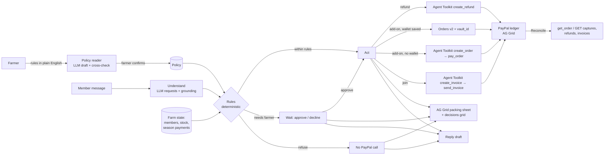
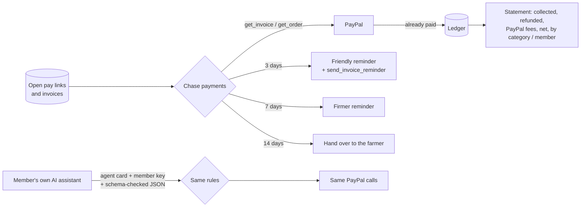

# Architecture

## Payments still owed, statement, agent-to-agent

- **Collections** (`src/collections.js`): PayPal is always asked first, so a member who already paid is never reminded and the ledger is corrected. An order the member approved but nobody captured is captured. Each stage is sent once. After the hand-over threshold the agent stops and the farmer decides.
- **Statement** (`buildStatement()` in `src/ledger.js`): built only from ledger rows, which are the PayPal objects. Fees come from each capture's `seller_receivable_breakdown`. Reconciliation differences carry a plain-language reason.
- **Agent-to-agent** (`src/a2a.js`): the member key (an HMAC of the member ID) identifies whose share it is, so a member's assistant can only act for that member. The request is validated against a JSON schema with no free-text fields, so nothing reaches the language model. It is then processed exactly like a typed message.

## Trust boundaries

| Component | Trusted for | Not trusted for |
|---|---|---|
| Farmer | the rules, approvals, sheet edits | |
| LLM (Qwen2.5-3B via Ollama) | reading rules and messages | amounts, quantities, items, sites, whether money moves |
| Member messages | what that member wants for their own share | instructions to the AI, anything about someone else's share |
| A member's AI assistant (agent-to-agent) | structured requests for that member's own share, proven by the member key | free text, other members, anything outside the schema |
| Rules (`src/rules.js`) | allow / needs farmer / refuse, and the amount | |
| PayPal | money, saved wallets, invoices, pay links | |

## Rules per request (`src/rules.js`)

| Request | Checks |
|---|---|
| all | policy confirmed; sender is the member (from their own email); no request about another member's share |
| skip a week | before the cutoff for *their* pickup site (pickup − notice hours); skips left this season; refund = one week of their share |
| add-on | stock left; their box not skipped; amount ≤ farmer's auto-charge limit, otherwise the farmer decides; saved wallet → charge, else PayPal pay link |
| swap | the item is in this week's box for their share size; before packing day |
| change pickup | a real, different site; this week if both sites' cutoffs allow, otherwise next week |
| missing / spoiled | the items were in their box; value at farm prices ≤ no-questions refund limit, otherwise the farmer decides; once per week |
| join | sender is not a member; mid-season joins allowed; price = weeks left × weekly price → invoice |
| season refund | always the farmer; suggested amount = remaining weeks |
| any refund | ≤ what is still refundable on that member's season capture |
| any money, if the message contains instructions aimed at the AI | the farmer decides |

When the farmer approves, the hard rules (stock, refundable balance, identity) run again before any money moves.

## Grounding the model

- `crossCheck()` (`src/policy.js`): a number the farmer wrote overrides the model; a number the farmer never wrote is replaced with a safe default (0 means "always ask me"); yes/no settings follow the text.
- `ground()` (`src/intents.js`): a request survives only if the message supports it. The add-on must be named, the quantity comes from the text ("2 dozen eggs" → 2), produce items must appear, and the site must be named. High-precision detectors add requests the model missed (for example the bread in "eggs and a sourdough loaf"), and each change is shown to the farmer.

## Mock vs sandbox

`src/paypal.js` exposes one surface with two backends. **sandbox** uses `@paypal/agent-toolkit` (`handleToolCall`) for orders, captures, refunds and invoices, plus direct REST for Vault v3 and vault-funded orders. **mock** simulates the same objects in-process (orders, captures with partial refunds, invoices, saved wallets) and serves labeled stand-in buyer pages, so the full demo runs offline and the tests need no network.
